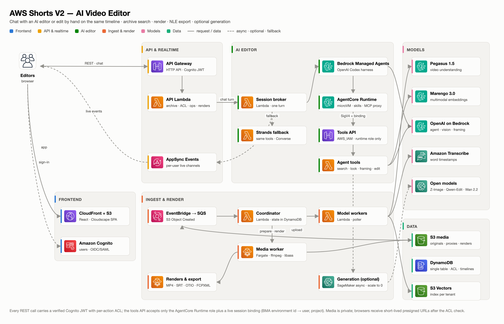

# AWS Shorts V2 — AI Video Editor

Turn your video archive into finished short-form (or long-form) videos by chatting with an AI editor — and take
over with a manual editor whenever you want. Built on **Amazon Bedrock AgentCore**, **Bedrock Managed Agents
(with OpenAI)**, **TwelveLabs Pegasus 1.5 / Marengo 3.0 on Amazon Bedrock** and **Amazon S3 Vectors**.

> V1 (Step Functions + Lambda) is preserved at tag [`v1-legacy`](../../tree/v1-legacy).

**Design principle — easy by default, as deep as you want.** One sentence gets a complete edit; every AI decision
is inspectable, every property is editable, and your manual edits are pinned so the AI never overwrites them.

| Level | What you do |
|---|---|
| L0 | Pick footage, describe the video in one line → finished edit |
| L1 | One-click refinements (shorter, caption style, music, 16:9 version) |
| L2 | Select a clip and tell the AI what to change |
| L3/L4 | Manual mode: drag/trim/split, inspector (layout, focus, speed, volume, transitions, text), versions, undo |
| L5 | Export OTIO / FCPXML / EDL to Premiere, DaVinci Resolve or Final Cut; timeline JSON; skills |

## What it does

- **Archive**: upload video, images, audio, PDF/PPT (no size limit; multipart direct to S3). Event-driven ingest
  builds proxies, sprites, waveforms and analysis chunks, then:
  - Marengo 3.0 embeddings (visual / audio / transcription, shot-based segments) → S3 Vectors (one index per tenant)
  - Pegasus 1.5 summaries, chapters and timestamped scenes **in the workspace language**
  - Amazon Transcribe word-level transcripts
  - Duplicate uploads are detected by S3's CRC64NVME checksum and reuse all analysis
- **Search** in natural language or by image, with per-modality normalization and weights.
- **Sharing**: tenants › groups › users; Owner / Editor / User roles; collections; expiring grants; access
  requests; audit log. No permission = invisible.
- **AI editor**: Bedrock Managed Agents (OpenAI Codex harness) runs in an AgentCore Runtime microVM with a small
  set of general tools (search, look at frames, read transcript, ask Pegasus, analyze framing, snap cuts, edit
  timeline, ask the user) and genre skills (lecture, nature, sports, interview, tutorial, highlight, recap,
  supercut, B-roll, top-N, slideshow, vertical reframing). A Strands Agents fallback uses the same tools.
- **Vertical reframing**: a vision model picks a per-shot subject focus and a layout — crop, split (speaker +
  slide), blurred fill or letterbox.
- **Render**: FFmpeg on Fargate renders MP4 with burned-in word-timed captions (+ SRT/VTT), music ducked under
  speech and loudness normalization.

## Architecture

<picture>
  <source media="(prefers-color-scheme: dark)" srcset="docs/architecture/architecture-dark.png">
  
</picture>

<sub>Source: [`docs/architecture/architecture.html`](docs/architecture/architecture.html) (HTML/SVG, palette validated for color-vision deficiency in light and dark). Regenerate the PNGs with `node docs/architecture/render.mjs` (Playwright). Service icons: [AWS Architecture Icons](https://aws.amazon.com/architecture/icons/).</sub>

Request flow in short:

```
Browser (React + Cloudscape, CloudFront)
  ├─ REST ─▶ API Gateway (Cognito JWT) ─▶ API Lambda ─▶ DynamoDB · S3 · S3 Vectors · Bedrock
  ├─ chat ─▶ API ─▶ Broker Lambda ─▶ Bedrock Managed Agents ─▶ AgentCore Runtime microVM
  │                                    └ stdio MCP proxy ─SigV4─▶ Tools API (IAM: runtime role only) ─▶ tools
  └─ realtime ◀─ AppSync Events (per-user channels)
S3 upload ─▶ EventBridge ─▶ SQS ─▶ coordinator ─▶ Fargate media worker (ffmpeg) / model workers / poller
```

How the agent acts for a user: the broker records the BMA session's `environment_id → (tenant, user, project)`.
Inside the microVM the tool proxy reads the same id from the lifecycle state and signs requests with the runtime
role. The tools API accepts only that role and only live bindings, then enforces the user's ACL on every call.
No credentials are placed in prompts or tool configuration.

## Repository layout

| Path | Contents |
|---|---|
| `infra/` | AWS CDK app (stacks: Web, Core, Ingest, Agent, Api, WebDeploy) |
| `services/` | Python backend (`shorts` package): API, ingest, model tasks, agent tools, broker, renderer, export |
| `services/media-worker/` | Fargate image (ffmpeg, libass, poppler, LibreOffice, CJK fonts) |
| `services/src/shorts/skills/` | Editing skills (`SKILL.md`), shared by both orchestrators |
| `agents/runtime/` | AgentCore Runtime image for Bedrock Managed Agents + MCP tool proxy |
| `web/` | React + Vite + Cloudscape (One Theme, light/dark) |
| `packages/timeline/` | Shared timeline model (TypeScript) |
| `docs/SPEC.md` | Product & technical decisions |

## Deploy

Prerequisites: AWS account with access to `twelvelabs.pegasus-1-5`, `twelvelabs.marengo-embed-3-0`, OpenAI models on
Bedrock (`openai.gpt-5.6-luna`, `openai.gpt-6.1-sol`) and Bedrock Managed Agents (preview); Node 20+, pnpm, Python
3.12+ with `uv`, Docker. Region: `us-east-1` (Marengo is not available in every region).

```bash
pnpm install
pnpm --filter web build
cd infra
npx cdk bootstrap                       # once per account/region
npx cdk deploy --all -c mode=edit       # -c mode=full enables generation (roadmap)
```

Context flags (`infra/cdk.json`): `mode` (`edit` | `full`), `selfSignUp` (set `false` for invite-only pools),
`bmaModelId`, `allowedLocalOrigins`.

Create the first user (invite-only pools):

```bash
uv run --project services python scripts/create_user.py --email you@example.com --tenant-name "My team" --language ko
```

Local web development: create `web/public/config.json` from the stack outputs and run `pnpm --filter web dev`
(binds `127.0.0.1:5173` only).

## Security notes

- Every REST route requires a verified Cognito JWT; authorization (tenant isolation + role per action) is enforced
  in the handlers. Media buckets are private (Block Public Access, TLS only); browsers get short-lived presigned URLs
  only after the ACL check.
- The agent tools API is AWS_IAM-only and accepts just the AgentCore Runtime role; content inside videos,
  transcripts and documents is treated as data, never as instructions.
- Bedrock Managed Agents is in preview — APIs may change.

## Tests

```bash
cd services && uv run pytest -q     # ACL, ingest state machine, timeline ops, renderer, exports
```

## License

MIT-0. See [LICENSE](LICENSE).
